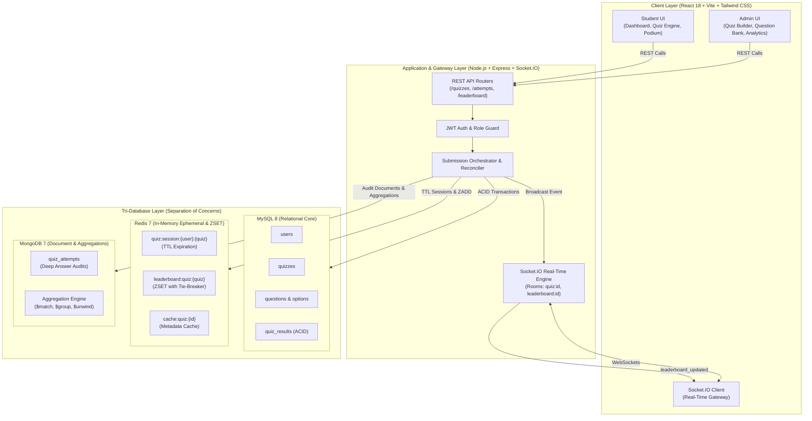
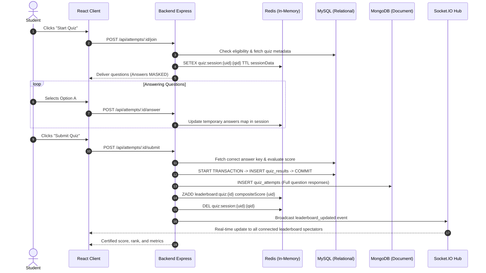

# System Architecture & Tri-Database Integration

## 1. Architectural Overview

The **Online Quiz Platform with Real-Time Leaderboard** is an enterprise-grade full-stack web application architected specifically as a college Database Management Systems (DBMS) project. Its primary purpose is to demonstrate the distinct, non-overlapping architectural strengths of three major database paradigms:

1. **MySQL (Relational Database)**: Transactional integrity, ACID guarantees, 3NF schema, referential integrity.
2. **Redis (In-Memory Database)**: High-speed O(log N) Sorted Sets for real-time leaderboards, deterministic tie-breaking, TTL ephemeral session cleanup, and metadata caching.
3. **MongoDB (Document Database)**: Granular attempt history documents, answer audit trails, and multi-stage aggregation reporting pipelines ($match, $group, $unwind, $lookup, $avg).

---

## 2. System Architecture Diagram

---

## 3. Separation of Database Responsibilities

| Dimension | MySQL 8 | Redis 7 | MongoDB 7 |
| :--- | :--- | :--- | :--- |
| **Data Model** | Relational Tables (Normalized 3NF) | Key-Value, Sorted Sets (ZSET), Hashes | Flexible Document JSON/BSON |
| **Primary Responsibility** | System of Record, User Accounts, Questions, Options, ACID Results | Sub-millisecond Leaderboard Ranking & Ephemeral TTL Sessions | Deep Question-Level Attempt Audit & Complex Analytical Aggregations |
| **Storage Mechanism** | Persistent Disk with InnoDB Buffer Pool | In-Memory with AOF / RDB Persistence | Memory-Mapped Persistent B-Trees |
| **Concurrency / ACID** | Full ACID (Atomicity, Consistency, Isolation, Durability) | Single-threaded atomic command execution | Document-level atomicity |
| **Academic Justification** | Prevents double submissions and ensures foreign key referential integrity | Eliminates costly SQL ORDER BY re-sorting on every live submission | Accommodates polymorphic question answer sets and unrolls arrays for item-level analysis |

---

## 4. Real-Time Data Flow During Quiz Lifecycle

---

## 5. Cross-Database Synchronization & Fault Tolerance

Because distributed transactions (two-phase commits) across relational, in-memory, and document stores introduce excessive latency, the system employs an **Idempotent Dual-Phase Architecture**:

1. **Authoritative Commitment**: The MySQL transaction commits first. If MySQL fails, the operation aborts cleanly and nothing is permanently recorded.
2. **Eventual Document & Cache Synchronization**:
   - MongoDB attempt insertion is executed within a try/catch guard.
   - Redis Sorted Set updates are executed next.
   - In the event of a cache or document network glitch, MySQL's certified result record remains intact. The `hydrateLeaderboardFromMySQL()` fallback method reconstructs Redis Sorted Sets on demand upon cache misses.

