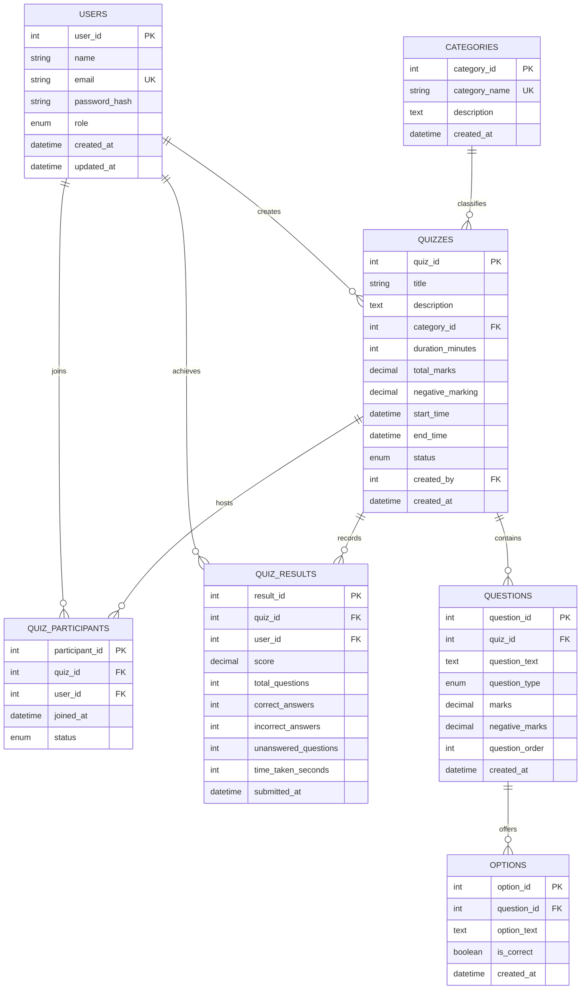

# Database Design & Academic DBMS Specifications

## 1. Entity-Relationship (ER) Diagram (MySQL Relational Schema)



---

## 2. Normalization Analysis (Up to 3NF)

### First Normal Form (1NF)
- **Criterion**: Every column contains atomic values, each record is uniquely identifiable by a primary key, and there are no repeating groups.
- **Implementation**: In our schema, question options are **not** stored as comma-separated strings inside `questions`; instead, each option is modeled as an independent tuple in the normalized `options` table with an atomic `option_id`.

### Second Normal Form (2NF)
- **Criterion**: The relation is in 1NF and every non-prime attribute is fully functionally dependent on the primary key (no partial dependencies on a composite candidate key).
- **Implementation**: In `quiz_results`, the natural candidate key is `(quiz_id, user_id)`. All metrics (`score`, `total_questions`, `correct_answers`, `time_taken_seconds`) depend strictly on the entirety of both the quiz taken and the student taking it. Question texts or user names are deliberately normalized out to prevent partial dependencies.

### Third Normal Form (3NF)
- **Criterion**: The relation is in 2NF and there are no transitive dependencies (non-prime attributes must not determine other non-prime attributes).
- **Implementation**: Quizzes reference `category_id` from a dedicated `categories` table. Category descriptions depend solely on `category_id`, eliminating transitive dependency ($quiz\_id \rightarrow category\_id \rightarrow category\_name$).

---

## 3. MySQL Table Structure & Indexing Strategy

| Table Name | Primary Key | Foreign Keys | Unique Constraints | Performance Indexes |
| :--- | :--- | :--- | :--- | :--- |
| `users` | `user_id` | — | `email` | `idx_users_role`, `idx_users_created_at` |
| `categories` | `category_id` | — | `category_name` | — |
| `quizzes` | `quiz_id` | `category_id`, `created_by` | — | `idx_quizzes_status`, `idx_quizzes_category` |
| `questions` | `question_id` | `quiz_id` | — | `idx_questions_quiz_order (quiz_id, question_order)` |
| `options` | `option_id` | `question_id` | — | `idx_options_question`, `idx_options_correct` |
| `quiz_participants`| `participant_id` | `quiz_id`, `user_id` | `(quiz_id, user_id)` | `idx_participants_status` |
| `quiz_results` | `result_id` | `quiz_id`, `user_id` | `(quiz_id, user_id)` | `idx_results_quiz_score (quiz_id, score DESC, time_taken_seconds ASC)` |

---

## 4. Redis In-Memory Architecture

### Feature 1: Real-Time Leaderboard via Sorted Sets (ZSET)
- **Key Pattern**: `leaderboard:quiz:{quizId}`
- **Data Structure**: Redis Sorted Set (ZSET)
- **Complexity**: $O(\log N)$ for insertion/updates (`ZADD`), $O(\log N + M)$ for retrieval (`ZREVRANGE`).
- **Deterministic Tie-Breaking Algorithm**:
  $$\text{Composite Score} = \text{Raw Score} + \frac{2 \times 10^{12} - \text{Submission Timestamp (ms)}}{10^{13}}$$
  - Because higher raw scores dominate the integer portion, the top scorer always ranks first.
  - When raw scores are identical, an earlier submission timestamp yields a larger decimal fractional bonus ($< 1$), breaking ties deterministically in accordance with official competition rules.
- **Commands**:
  - `ZADD leaderboard:quiz:1 23.75008241 2`
  - `ZREVRANGE leaderboard:quiz:1 0 9 WITHSCORES`
  - `ZREVRANK leaderboard:quiz:1 2`
  - `ZCARD leaderboard:quiz:1`

### Feature 2: Ephemeral Quiz Sessions via Redis TTL
- **Key Pattern**: `quiz:session:{userId}:{quizId}`
- **Data Structure**: String (Serialized JSON Object)
- **TTL Configuration**: $\text{Duration (seconds)} + 60\text{s grace period}$
- **Command**: `SETEX quiz:session:2:1 960 "{...}"`
- **Automatic Expiration**: When the deadline elapses, Redis automatically evicts the temporary session key, freeing server memory without manual cron sweeps.

---

## 5. MongoDB Document Architecture & Aggregation Pipelines

### Collection: `quiz_attempts`
```json
{
  "attemptId": "ATTEMPT_1731510000_U2_Q1",
  "userId": 2,
  "studentName": "Rahul Sharma",
  "quizId": 1,
  "quizTitle": "DBMS Relational Algebra & Normalization",
  "category": "Database Management Systems",
  "startedAt": "2026-11-13T10:00:00.000Z",
  "submittedAt": "2026-11-13T10:06:52.000Z",
  "score": 25.0,
  "totalMarks": 25.0,
  "timeTaken": 412,
  "correctCount": 5,
  "incorrectCount": 0,
  "unansweredCount": 0,
  "answers": [
    {
      "questionId": 1,
      "questionText": "Which normal form eliminates partial dependency...",
      "selectedOptionId": 2,
      "isCorrect": true,
      "marksAwarded": 5.0
    }
  ]
}
```

### Aggregation Pipeline: Question-Level Accuracy Audit
```javascript
db.quiz_attempts.aggregate([
  { $match: { quizId: 1 } },
  { $unwind: "$answers" },
  {
    $group: {
      _id: "$answers.questionId",
      questionText: { $first: "$answers.questionText" },
      totalAnswered: { $sum: 1 },
      correctCount: { $sum: { $cond: ["$answers.isCorrect", 1, 0] } }
    }
  },
  {
    $project: {
      questionId: "$_id",
      questionText: 1,
      accuracyPercentage: {
        $round: [{ $multiply: [{ $divide: ["$correctCount", "$totalAnswered"] }, 100] }, 1]
      }
    }
  },
  { $sort: { questionId: 1 } }
]);
```
