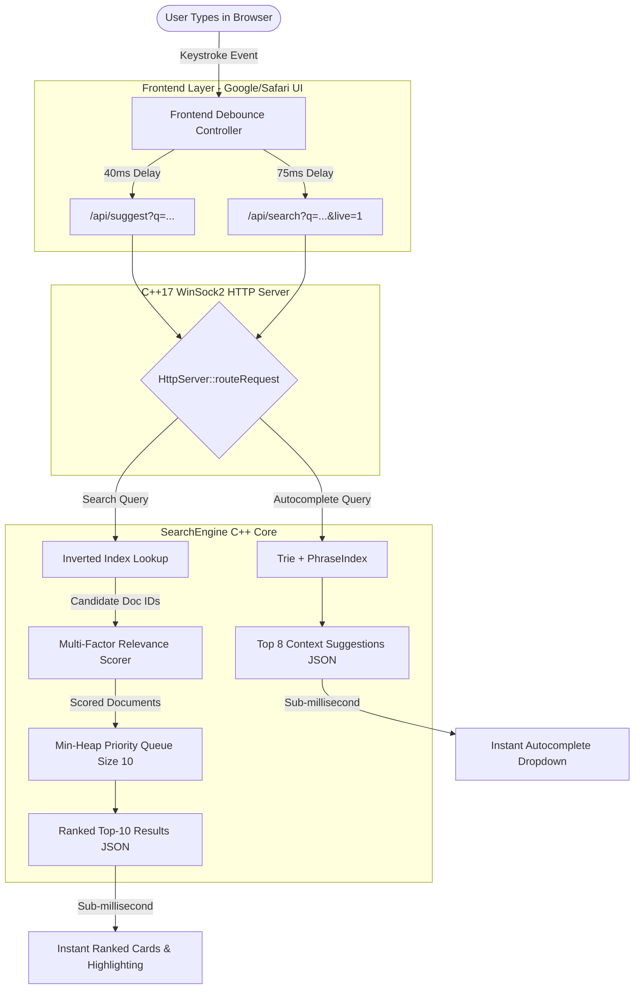

# Smart Search Engine with Autocomplete — Complete Project & Data Structures Guide (Hinglish)

> **College Project & Viva Master Guide**  
> Is guide me is pure project ka architectural concept, data structures (Trie, Inverted Index, Phrase Index, Min-Heap), algorithmic time/space complexities aur working mechanism ko **crystal-clear Hinglish** me diagrams ke saath explain kiya gaya hai. Isko padhne ke baad aap kisi bhi professor ya interviewer ko confidently explain kar sakte hain.

---

## Table of Contents
1. [Project Overview (Ye Project Kya Hai?)](#1-project-overview-ye-project-kya-hai)
2. [High-Level Architecture Diagram](#2-high-level-architecture-diagram)
3. [Data Structure 1: Trie (Prefix Tree for Autocomplete)](#3-data-structure-1-trie-prefix-tree-for-autocomplete)
4. [Data Structure 2: Phrase Index (N-Gram Context Engine)](#4-data-structure-2-phrase-index-n-gram-context-engine)
5. [Data Structure 3: Inverted Index (Fast Document Retrieval)](#5-data-structure-3-inverted-index-fast-document-retrieval)
6. [Data Structure 4: Min-Heap / Priority Queue (Top-K Ranking)](#6-data-structure-4-min-heap--priority-queue-top-k-ranking)
7. [Multi-Factor Scoring Formula (Relevance Calculation)](#7-multi-factor-scoring-formula-relevance-calculation)
8. [End-to-End Real-Time Execution Trace](#8-end-to-end-real-time-execution-trace)
9. [Viva Questions & Answers in Hinglish (College Exam Special)](#9-viva-questions--answers-in-hinglish-college-exam-special)

---

## 1. Project Overview (Ye Project Kya Hai?)

Jab hum **Google Chrome**, **Safari**, ya **Google Search** me koi query type karte hain (jaise `machine`), toh do cheezein instant hoti hain:
1. **Instant Autocomplete Suggestions:** Hame niche suggestions aate hain (`machine learning`, `machine learning using c++`, etc.).
2. **Real-Time Search Results:** Jaise-jaise keystrokes type hote hain, sub-millisecond ke andar relevant web pages rank ho kar samne aa jate hain.

Hamara project ek **C++17 High-Performance Information Retrieval Engine** hai jo bina kisi external heavy database (jaise Elasticsearch ya SQL) ke, purely **Core Data Structures & Algorithms** par chalta hai:
- **Trie:** Character-by-character prefix autocomplete ($O(L)$ time).
- **Phrase Index (N-Grams):** Multi-word context matching.
- **Inverted Index:** Document retrieval ($O(1)$ candidate lookup).
- **Min-Heap (Priority Queue):** Top-10 highest-ranked results filter karna ($O(N \log K)$ time).
- **WinSock2 Multi-threaded HTTP Server:** Sub-millisecond JSON REST API.

---

## 2. High-Level Architecture Diagram

Yaha dekhiye jab user browser me key press karta hai, toh internally kya hota hai:



---

## 3. Data Structure 1: Trie (Prefix Tree for Autocomplete)

### Concept Kya Hai?
Trie ek special **Tree-based Data Structure** hai jo strings ko character-by-character store karta hai. Har node ek character represent karta hai aur uske multiple children ho sakte hain.

### Diagram:
Maan lijiye humne words insert kiye: `"cat"`, `"car"`, `"cart"`, `"c++"`:

```text
                 [ ROOT ]
                    |
                   'c'
                  /   \
                'a'   '+'
                /       \
              't'       '+'* (c++)
             /   \
           [END]* 'r'
          ("cat")   \
                    't'* ("cart")
```
*(Node jisme `*` laga hai, wo `isEndOfWord = true` hai aur waha frequency score store hota hai)*.

### C++ Implementation Structure (`include/Trie.h`):
```cpp
struct TrieNode {
    std::unordered_map<char, TrieNode*> children;
    bool isEndOfWord;
    int frequency; // Query kitni baar search hui
    std::string fullWord;
};
```

### Why Trie instead of Linear Array Search?
| Approach | Time Complexity | Problem |
| :--- | :--- | :--- |
| **Linear Search (Array)** | $O(N \times L)$ | Har baar pure dataset ke $N$ words scan karne padenge. Agar 100,000 words hain toh typing lag hogi. |
| **Trie Prefix Search** | **$O(L)$** | Sirf typed prefix ke length $L$ tak tree traverse hota hai (jaise `"cat"` ke liye 3 steps). Dataset kitna bhi bada ho, speed constant rehti hai! |

---

## 4. Data Structure 2: Phrase Index (N-Gram Context Engine)

### Concept Kya Hai?
Trie akele sirf single word ka prefix jaanta hai (jaise `"mac"` $\rightarrow$ `"machine"`).  
Lekin agar user ne likha:  
`"machine learning using c++"`  
Toh search engine ko **pure phrase ka context** samajhna padega. Iske liye hum **PhraseIndex** (N-Gram Shingles) use karte hain.

### Diagram:
Ek sentence ko N-Grams me break karte hain:
```text
Document: "Machine learning projects using modern C++ programming"

Word Tokens: ["machine", "learning", "projects", "using", "modern", "c++", "programming"]

Bigrams (2-word phrases):
  ["machine learning"]
  ["learning projects"]
  ["projects using"]
  ["using modern"]
  ["modern c++"]

Trigrams (3-word phrases):
  ["machine learning projects"]
  ["learning projects using"]
  ["projects using modern"]
  ["using modern c++"]
```

### Kaise Kaam Karta Hai?
Hum in N-Grams ko ek Hash Map me store karte hain:
```cpp
std::unordered_map<std::string, int> phraseFrequencies;
```
Jab user do ya teen words type karta hai (jaise `"machine learn"`), toh engine:
1. Previous context (`"machine"`) ko identify karta hai.
2. Last word (`"learn"`) ka prefix match karta hai.
3. Suggestion list me `"machine learning"`, `"machine learning algorithms"`, `"machine learning using c++"` ko priority deta hai.

---

## 5. Data Structure 3: Inverted Index (Fast Document Retrieval)

### Concept Kya Hai?
Ye kisi bhi search engine (jaise Google) ka **sabse important data structure** hota hai.  
Normal book me:
- **Forward Index:** Chapter 1 $\rightarrow$ Pura text.
- **Inverted Index:** Book ke end ka Index page! (Word $\rightarrow$ Page numbers).

### Diagram:
```text
DOC 1: "C++ STL vector and data structures"
DOC 2: "Machine learning algorithms and data structures"
DOC 3: "Introduction to C++ programming and pointers"

               INVERTED INDEX (Hash Map)
------------------------------------------------------
Token (Word)           Posting List (Doc IDs)
------------------------------------------------------
"c++"           --->   [ Doc 1, Doc 3 ]
"data"          --->   [ Doc 1, Doc 2 ]
"structures"    --->   [ Doc 1, Doc 2 ]
"machine"       --->   [ Doc 2 ]
"learning"      --->   [ Doc 2 ]
"pointers"      --->   [ Doc 3 ]
```

### C++ Implementation Structure (`include/SearchEngine.h`):
```cpp
// Token -> List of Document IDs
std::unordered_map<std::string, std::vector<int>> invertedIndex;
```

### Why Inverted Index is Super Fast?
Agar corpus me 1,000,000 documents hain aur user ne search kiya `"machine learning"`:
- **Naive Search:** 1,000,000 documents ke text ko loop me string find karna padega $\rightarrow$ Extreme Slow.
- **Inverted Index Search:** 
  1. `invertedIndex["machine"]` dekha $\rightarrow$ `[Doc 2, Doc 15, Doc 89]` ($O(1)$ hash lookup)
  2. `invertedIndex["learning"]` dekha $\rightarrow$ `[Doc 2, Doc 89, Doc 104]` ($O(1)$ hash lookup)
  3. Dono sets ka Union/Intersection liya $\rightarrow$ Sirf 4 documents candidate bane.
  4. Scorer sirf inhi 4 documents ko score karta hai!

---

## 6. Data Structure 4: Min-Heap / Priority Queue (Top-K Ranking)

### Concept Kya Hai?
Jab search engine documents ko score karta hai, toh 1,000 candidate documents ho sakte hain. Lekin user ko pehle page par sirf **Top 10** results dekhne hote hain.

Agar hum pure 1,000 documents ko sort karenge using `std::sort`:
- Time Complexity: $O(N \log N)$

Lekin agar hum **Min-Heap (Priority Queue)** use karein of fixed size $K = 10$:
- Time Complexity: **$O(N \log K)$** (jaha $K = 10$, jo ki practically constant hai!).

### Diagram:
```text
Candidates Scored:
Doc 1 (Score: 240)
Doc 2 (Score: 95)
Doc 3 (Score: 180)
Doc 4 (Score: 310)
...

Min-Heap of Size 3 (Example with K=3):

Step 1: Insert Doc 1 (240)
Step 2: Insert Doc 2 (95)
Step 3: Insert Doc 3 (180)

Heap Status:
          [ Doc 2: 95 ]  <-- Root (Minimum score among top-K)
          /           \
   [ Doc 3: 180 ]   [ Doc 1: 240 ]

Step 4: Doc 4 arrives with Score 310.
        310 > 95 (root score).
        Toh Doc 2 pop ho jata hai aur Doc 4 heap me push ho jata hai!

Heap Status ab:
          [ Doc 3: 180 ] <-- Naya minimum
          /           \
   [ Doc 1: 240 ]   [ Doc 4: 310 ]
```

### C++ Comparator Implementation:
```cpp
struct SearchResultComparator {
    bool operator()(const SearchResult& a, const SearchResult& b) const {
        return a.score > b.score; // Min-heap: Lowest score at the top
    }
};

// Priority Queue declaration:
std::priority_queue<SearchResult, std::vector<SearchResult>, SearchResultComparator> minHeap;

for (const auto& candidate : allCandidates) {
    if (minHeap.size() < 10) {
        minHeap.push(candidate);
    } else if (candidate.score > minHeap.top().score) {
        minHeap.pop();
        minHeap.push(candidate);
    }
}
```

---

## 7. Multi-Factor Scoring Formula (Relevance Calculation)

Hamara engine Google ki tarah multi-factor relevance formula use karta hai. Har document ka score multiple signals ko jod kar banta hai:

$$\text{Final Score} = S_{\text{title\_exact}} + S_{\text{title\_phrase}} + S_{\text{title\_terms}} + S_{\text{keywords}} + S_{\text{coverage}} + S_{\text{proximity}} + S_{\text{popularity}}$$

### Point Breakdown Table:
| Factor | Points Awarded | Logic & Reason |
| :--- | :--- | :--- |
| **Exact Full Title Match** | **$+140$ pts** | Agar document ka title exactly user query se match ho gaya (e.g., query `"Machine Learning"` and title `"Machine Learning"`). |
| **Phrase in Title** | **$+85$ pts** | Agar user ka multi-word phrase document ke title me as-is exist karta hai. |
| **Title Word Matches** | **$+25$ pts / word** | Title me query ka har individual word milne par. |
| **Keyword Pill Match** | **$+35$ pts / keyword** | Author-defined tags/keywords match hone par. |
| **Query Term Coverage** | **Up to $+70$ pts** | $\left(\frac{\text{matched query tokens}}{\text{total query tokens}}\right) \times 70$. Dono words milne wale document ko ek word milne wale se aage rakhta hai. |
| **Term Proximity Bonus** | **$+25$ pts** | Agar query ke multiple words document ke andar ek dusre ke paas (adjacent) hain. |
| **Baseline Popularity** | **$\text{popularity} \times 0.25$** | Quality and click-through prior score. |

---

## 8. End-to-End Real-Time Execution Trace

### Scenario: User types `"machine learning"` in real time

1. **User types `'m'`:**
   - Frontend 40ms debounce: Trie prefix search runs for `'m'` $\rightarrow$ returns `["machine learning", "map", "merge sort", ...]`.
   - Frontend 75ms debounce: Live search runs (`/api/search?q=m&live=1`). Documents matching `'m'` render live with `Live Instant` badge.
   - `live=1` hone ki wajah se search history me single letter `'m'` save **nahi** hota.

2. **User types `'machine'`:**
   - Trie suggestions instantly update to phrases starting with `machine`.
   - Inverted Index retrieves documents with token `"machine"`. Top results render immediately ($<1\text{ms}$).

3. **User types `'machine learning'`:**
   - PhraseIndex recognizes the bigram context `"machine learning"`.
   - Inverted Index intersects posting list of `"machine"` and `"learning"`.
   - Scorer gives **$+140$ (exact title)** $+$ **$+70$ (full coverage)** $+$ **$+25$ (proximity)**.
   - Min-heap places the official Machine Learning article at **Rank #1**.

4. **User clicks a Result or presses Enter:**
   - Search commit call fires (`/api/search?q=machine%20learning`).
   - Query `history.txt` me log hoti hai aur Trie/PhraseIndex frequency self-increment hoti hai. Engine automatically user behavior se learn karta hai!

---

## 9. Viva Questions & Answers in Hinglish (College Exam Special)

### Q1: Autocomplete ke liye Trie kyun choose kiya, Hash Map ya Binary Search Tree kyun nahi?
> **Answer:**  
> "Sir, Hash Map exact key match ($O(1)$) ke liye best hota hai, lekin wo prefix match nahi kar sakta (jaise `'mac'` search karne par `'machine'` dhundhna).  
> Binary Search Tree me string prefix search karne me $O(L \log N)$ time lagta hai.  
> Jabki **Trie** specifically prefix-based retrieval ke liye design hota hai jisme prefix search time sirf $O(L)$ hota hai, jaha $L$ length of the typed string hai. Iska speed dataset ke size par depend nahi karta, isliye typing ke dauraan real-time 60 FPS response milta hai."

---

### Q2: Inverted Index kya hota hai aur is project me uska kya role hai?
> **Answer:**  
> "Sir, Inverted Index ek mapping hoti hai from **Words $\rightarrow$ Document IDs**. Normal storage me Document se words milte hain (Forward Index), lekin search engine me hume word se document dhundhna hota hai.  
> Hamare project me humne `unordered_map<string, vector<int>>` use kiya hai. Iski wajah se hume pure dataset ke documents ko line-by-line scan nahi karna padta. Ek hash lookup me pata chal jata hai ki kaun-kaun se documents me ye word exist karta hai."

---

### Q3: Top 10 results sort karne ke liye `std::sort` ke badle Min-Heap kyun use kiya?
> **Answer:**  
> "Sir, agar corpus bada ho aur 10,000 documents match ho jayein, toh pure array ko `std::sort` karne me $O(N \log N)$ time lagega jo inefficient hai kyunki hume sirf top 10 chahiye.  
> Humne **Min-Heap** of size $K=10$ use kiya hai. Min-heap ke root par hamesha current top 10 ka lowest score rehta hai. Jab naya document aata hai, hum sirf root se compare karte hain. Isse time complexity $O(N \log N)$ se reduce ho kar **$O(N \log K)$** ho jati hai ($K=10$ constant)."

---

### Q4: Context-aware search engine ka kya matlab hai?
> **Answer:**  
> "Sir, basic autocomplete sirf last word ka prefix dekhta hai. Context-aware autocomplete pure query phrase ko samajhta hai.  
> Example: Agar user likhta hai `'machine learning using'`, toh basic Trie fail ho jayega kyunki wo sirf single words janta hai. Hamara **PhraseIndex (N-gram)** engine pichle words `'machine learning'` ka context yaad rakhta hai aur aage suggest karta hai `'machine learning using C++'` ya `'machine learning using Python'`."

---

### Q5: Jab user fast typing karta hai, toh backend crash ya lag kyun nahi hota?
> **Answer:**  
> "Sir, iske liye humne do optimizations kiye hain:  
> 1. **Frontend Debouncing:** Keystroke aate hi turant har millisecond network request nahi bhejte, balki 40ms/75ms ka minimal debounce timer rakha hai.  
> 2. **Request ID Guard:** Fast typing me purani request nayi request ke baad aane par race condition se results overwrite na ho, iske liye monotonic Request ID check hoti hai.  
> 3. **Live Param (`live=1`):** Incomplete keystrokes database ya history file me write nahi hoti, sirf read-only memory cache se sub-millisecond me serve hoti hain."

---

### Q6: WinSock2 HTTP Server ka kya role hai? Kya isme Node.js ya Python use hua hai?
> **Answer:**  
> "Sir, is project me koi bhi external server jaise Node.js, Express, ya Python use nahi hua hai. Pure backend ko standard C++17 aur Windows Native **WinSock2** sockets API se banaya gaya hai. Ye zero-dependency standalone `.exe` generate karta hai aur HTTP GET/DELETE requests ko raw TCP sockets ke through sub-millisecond latency me serve karta hai."

---

## 10. Summary Cheat Sheet for Presentation

```text
+-----------------------+-----------------------------+-----------------------+
| Component             | Data Structure / Algorithm  | Time Complexity       |
+-----------------------+-----------------------------+-----------------------+
| Prefix Autocomplete   | Trie (Prefix Tree)          | O(L) [L = prefix len] |
| Context N-Grams       | PhraseIndex (Hash Map)      | O(1) avg lookup       |
| Document Lookup       | Inverted Index (Postings)   | O(1) per token        |
| Top-K Ranking         | Min-Heap (Priority Queue)   | O(N log K) [K = 10]   |
| Network Layer         | WinSock2 Non-blocking TCP   | Sub-millisecond       |
+-----------------------+-----------------------------+-----------------------+
```
